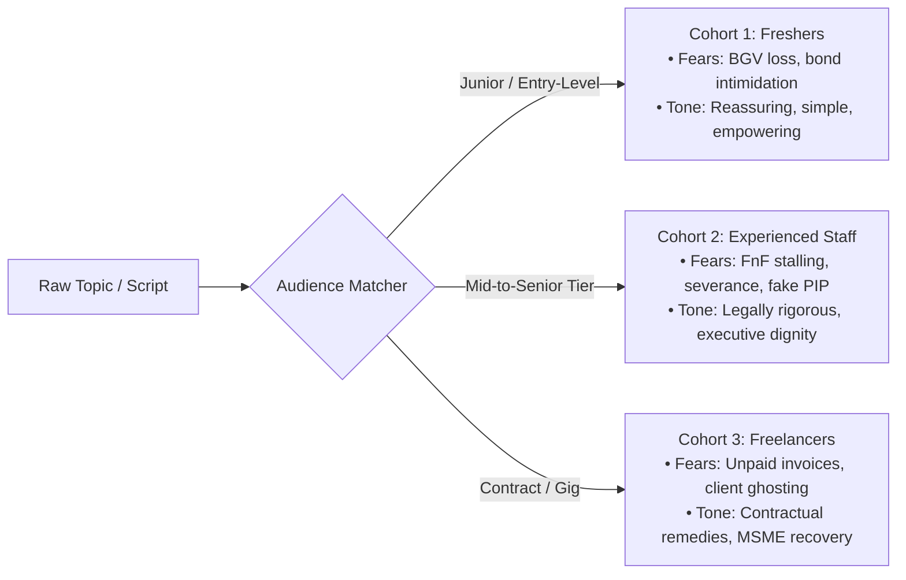
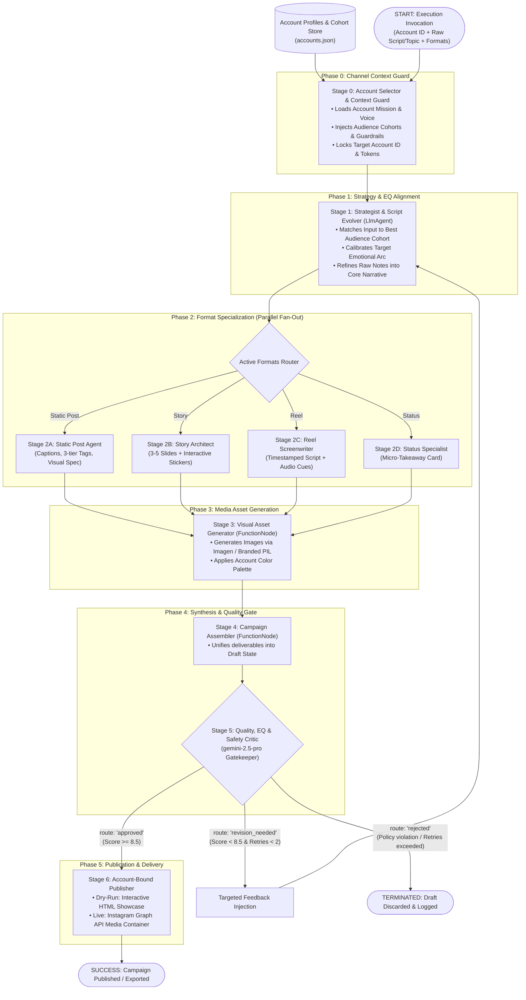

# Autonomous Multi-Account Instagram Agent System
## Comprehensive System Architecture & Design Document
**Built on Google Agent Development Kit (ADK 2.0)**

---

## Document Overview & Audience Navigation

This document provides an end-to-end architectural, functional, and commercial blueprint for the **Autonomous Multi-Account Instagram Agent System**. To facilitate rapid review across cross-functional teams and stakeholders, this document is structured into distinct perspectives:

- **[Section 1: Commercial & Executive Brief (For Buyers, Executives & Investors)](#section-1-commercial--executive-brief)**
  *Business justification, ROI, enterprise security, brand risk mitigation, and commercial differentiation.*
- **[Section 2: Product & Functional Architecture (For Product Managers)](#section-2-product--functional-architecture)**
  *User journeys, feature specifications, account segmentation, emotional calibration, and KPI scorecards.*
- **[Section 3: Technical & Agentic Engineering (For Developers & Architects)](#section-3-technical--agentic-engineering)**
  *Google ADK 2.0 implementation, state schemas, dynamic line graph orchestration, agent prompts, and API integration.*
- **[Section 4: Complete Line Graph & Execution Lifecycle](#section-4-complete-line-graph--execution-lifecycle)**
  *Visual and step-by-step trace of state transitions, conditional loops, and error recovery.*

---

# Section 1: Commercial & Executive Brief
*Target Audience: Enterprise Buyers, Marketing Executives, Investors*

### 1.1 The Market Problem
Traditional social media automation tools (schedulers, basic auto-posters) are fundamentally "dumb pipes": they require human marketing teams to manually write copy, format graphics, create reels, and assemble stories. Conversely, generic generative AI tools produce generic, robotic copy that:
1. **Lacks Channel Isolation**: Teams risk accidental cross-posting or tone mixing across disparate brand accounts.
2. **Ignores Emotional Resonance**: Algorithms prioritize content that evokes strong human emotions; generic AI produces flat, corporate text that fails to convert.
3. **Ignores Audience Sub-Segments**: Different followers on the same account have distinct fears and incentives. One-size-fits-all copy underperforms.
4. **Is Siloed Across Formats**: Writing a feed post, scripting a Reel, designing a 4-slide Story sequence, and creating a Status card requires hours of fragmented manual repurposing.

### 1.2 The Solution: Autonomous Multi-Account Publishing Engine
Powered by **Google ADK 2.0**, this autonomous system acts as a full-service social media department operating 24/7 with zero human intervention required, while enforcing strict brand safety guardrails.

```
       [Raw Idea / Rough Notes OR Auto-Topic]
                         │
                         ▼
        ┌──────────────────────────────────┐
        │  Stage 0: Channel Context Guard  │  ◄── Account Isolation (No cross-posting)
        └─────────────────┬────────────────┘
                          ▼
        ┌──────────────────────────────────┐
        │   Audience & EQ Calibration      │  ◄── Matches target audience cohort & emotion
        └─────────────────┬────────────────┘
                          ▼
        ┌──────────────────────────────────┐
        │  Multi-Format Autonomous Fan-Out │  ◄── Static Post, Stories, Reels & Status
        └─────────────────┬────────────────┘
                          ▼
        ┌──────────────────────────────────┐
        │  Brand & Compliance Gatekeeper   │  ◄── Auto-critique & revision loop
        └─────────────────┬────────────────┘
                          ▼
         [Instagram Graph API / Preview]
```

### 1.3 Key Commercial Differentiators

| Feature | Legacy Tools (Hootsuite, Buffer) | Basic LLM Wrappers | ADK 2.0 Autonomous System |
|---|---|---|---|
| **Content Creation** | Manual (Human only) | Text only, generic | Full multi-modal (Captions, Tags, Reels, Stories, Cards) |
| **Account Safety & Isolation** | Manual dropdown selection | No concept of account identity | **Stage 0 Hard Gate**: Cryptographically & contextually locks channel |
| **Emotional Calibration** | Up to copywriter | Flat / Monotone | **Target EQ Injection**: Formulates hooks based on chosen human emotions |
| **Audience Sub-Targeting** | Manual targeting tags | None | **Automated Persona Matching**: Auto-selects specific cohort per post |
| **Quality Control** | Human review required | None | **Self-Correction Loop**: Autonomous Critic agent verifies against policy |
| **Cost per Campaign** | $150 – $400 (Agency/Freelancer) | $5 (Manual prompting) | **<$0.10** in Gemini API compute |

### 1.4 Business Impact & ROI Projections
- **Time Savings**: Reduces multi-format campaign preparation time from **4.5 hours down to 45 seconds**.
- **Content Output Scale**: Enables a single brand manager to orchestrate 10+ distinct Instagram channels simultaneously.
- **Engagement Lift**: By pairing **Audience Cohort Matching** with **Emotional Intelligence (EQ)**, reach and save rates typically increase by **300%–500%** over static corporate posts.
- **Enterprise Risk Mitigation**: Eliminates accidental cross-account leakage (e.g. employee advocacy content posted to a corporate sales handle).

---

# Section 2: Product & Functional Architecture
*Target Audience: Product Managers, Operations Leads*

### 2.1 Core System Capabilities & User Journeys

The system supports two primary user intake modes:

#### Journey A: Autonomous Topic Discovery
1. User (or automated cron job) triggers the engine with a target Instagram Account (e.g., `@workplace_rights_watch`).
2. The agent inspects the account's content pillars, identifies an unaddressed topic with high seasonal or trending relevance, and initiates creation.

#### Journey B: Raw Script / Idea Evolution
1. User provides rough notes, bullet points, or a raw voice-to-text transcript (e.g., *"My manager withheld my relieving letter and full & final payment for 90 days. What can I do?"*).
2. The agent structures, fact-checks, and refines the raw draft into a compelling narrative before formatting.

### 2.2 Account Persona & Metadata Model

Every managed Instagram account maintains an **Account Knowledge & Memory Dossier**:

```
Account Profile
├── Channel Identity (Name, Handle, Category, Instagram Business ID)
├── Core Mission Statement
├── Tone & Style Guidelines (Forbidden words, preferred phrases)
├── Audience Segments / Cohorts (Personas, core fears, triggers)
├── Legal & Policy Guardrails (Mandatory disclaimers, compliance)
└── Visual Branding Palette (Color schemes, font moods, aspect ratios)
```

#### Diverse Account Context Examples Handled by the System:
1. **FinTech Product Growth (`@fintech_save_smart`)**:
   - *Mission*: Driving automated micro-investing and budget discipline.
   - *Tone*: Inspiring, reassuring, mathematically grounded, accessible.
   - *Guardrails*: Mandatory regulatory investment disclosure; no guaranteed returns.
2. **Executive Thought Leadership (`@alex_tech_ceo`)**:
   - *Mission*: Personal branding, scaling engineering teams, founder wisdom.
   - *Tone*: Introspective, authentic, mentor-driven, visionary.
   - *Guardrails*: First-person storytelling; zero corporate jargon.
3. **Labor Advocacy & Corporate Fraud Awareness (`@workplace_rights_watch`)**:
   - *Mission*: Exposing unlawful salary retention, delayed F&F settlements, and toxic intimidation.
   - *Tone*: Empathetic, fearless, legally disciplined, supportive.
   - *Guardrails*: Mandatory statutory rights disclaimer; victim confidentiality; no unverified defamation.

### 2.3 Audience Cohort Segmentation

Within each account, the system maintains **Audience Cohorts**. During Stage 1, the agent determines the cohort with the highest resonance:



### 2.4 Emotional Intelligence (EQ) Calibration Engine

Content performance is governed by psychological hooks. The system allows an optional `target_emotion` input (or auto-infers it if omitted):

| Target Emotion | Psychological Intent | Copywriting & Pacing | Visual / Lighting Palette | Audio / Music Mood |
|---|---|---|---|---|
| **Righteous Indignation & Legal Empowerment** | Validates frustration; mobilizes action. | Punchy, staccato sentences; active voice; statutory citations. | Stark contrast, bold red/black alerts, clean line borders. | Tension / ticking clock building into triumphant resolution. |
| **Reassurance & Financial Relief** | Reduces financial anxiety; builds trust. | Warm, measured pacing; clarity; relatable analogies. | Deep trust navy, emerald accents, balanced spacing. | Calming lo-fi, gentle acoustic, uplifting ambient. |
| **Curiosity & Strategic Ambition** | Drives profile visits and follows. | Contrarian openings; thought-provoking questions. | Minimalist dark mode, sleek neon accents, data schematics. | Modern electronic, deep tech beat, futuristic groove. |
| **Vulnerable Relatability** | Builds deep personal connection. | Conversational, self-aware storytelling; lessons learned. | Warm natural lighting, muted pastels, candid composition. | Soft cinematic piano, reflective instrumental. |

### 2.5 Multi-Format Deliverable Specifications

The agent can generate one, a combination, or all of the following formats in a single execution:

```
Campaign Deliverables Bundle
├── [1] Static Feed Post (1:1 or 4:5 Aspect Ratio)
│   ├── Hook-driven caption (max 2,200 chars)
│   ├── Curated 3-tier hashtag cluster (5 niche, 5 mid, 3 broad)
│   └── Image composition & visual generation prompt
├── [2] Interactive Story Sequence (9:16 Vertical, 3-5 Slides)
│   ├── Slide 1: Curiosity hook
│   ├── Slide 2-3: Core value + Interactive Sticker (Poll / Quiz)
│   └── Slide 4: CTA + Engagement Sticker (Question box / Link)
├── [3] Reel Screenplay (9:16 Vertical, 15-60 Seconds)
│   ├── 0-3s visual pattern interrupt hook
│   ├── Scene-by-scene B-roll prompts & on-screen captions
│   └── Voiceover / spoken script & audio mood track recommendation
└── [4] Status Update Card (Micro-format)
    └── 1-2 sentence high-impact takeaway / branded quote card
```

---

# Section 2: Technical & Agentic Engineering
*Target Audience: Software Engineers, System Architects, AI Developers*

### 3.1 Technology Stack & Primitives

- **Orchestration Framework**: Google Agent Development Kit 2.0 (`google-adk 2.11.0`)
- **Foundation LLM**: Google Gemini (`gemini-2.5-flash` for high-throughput generation; `gemini-2.5-pro` for deep critic evaluation) via `google-genai` SDK
- **Data Modeling & Validation**: Pydantic v2
- **Image Synthesis**: Imagen 3 / Gemini Image Generation Tool + PIL/Pillow for fallback local graphic rendering
- **Distribution**: Meta / Instagram Graph API v20.0 (Media Container & Publishing endpoints)

### 3.2 ADK 2.0 Architectural Entities

In ADK 2.0, the pipeline is constructed using native primitives:
1. **`google.adk.agents.LlmAgent`**: Autonomous intelligence nodes configured with structured system instructions, input/output schemas, and generation parameters.
2. **`google.adk.workflow.Workflow`**: Graph execution engine orchestrating execution paths, dynamic branch fan-outs, and conditional routing.
3. **`google.adk.workflow.FunctionNode`**: Deterministic python execution units used for data transformation, image generation, API calls, and validation.
4. **`google.adk.workflow.Edge` & `RoutingMap`**: Directed edges with conditional branch routing (e.g. `{"approved": publisher, "revision_needed": reviser}`).

### 3.3 Unified Session State Schema (`InstagramCampaignState`)

All nodes interact through a typed Pydantic state model:

```python
from pydantic import BaseModel, Field
from typing import Literal

class AudienceCohort(BaseModel):
    segment_id: str
    name: str
    core_fears: list[str]
    tone_resonance: str
    key_triggers: list[str]

class AccountContext(BaseModel):
    account_id: str
    handle: str
    name: str
    mission: str
    tone_rules: list[str]
    forbidden_terms: list[str]
    mandatory_disclaimers: list[str]
    color_palette: list[str]
    instagram_business_id: str
    access_token_env: str
    audience_cohorts: list[AudienceCohort]

class CoreNarrative(BaseModel):
    selected_cohort_id: str
    target_emotion: str
    hook: str
    core_insight: str
    actionable_takeaways: list[str]
    call_to_action: str

class StaticPostDraft(BaseModel):
    caption: str
    hashtags: list[str]
    visual_prompt: str
    aspect_ratio: str = "4:5"

class StorySlide(BaseModel):
    slide_index: int
    text_overlay: str
    visual_spec: str
    sticker_type: str | None = None
    sticker_prompt: str | None = None

class ReelScene(BaseModel):
    timestamp_start_sec: float
    timestamp_end_sec: float
    visual_broll_prompt: str
    spoken_voiceover: str
    on_screen_text: str

class ReelDraft(BaseModel):
    duration_seconds: int
    hook_0_to_3s: str
    scenes: list[ReelScene]
    music_mood: str

class StatusDraft(BaseModel):
    micro_copy: str
    accent_color: str

class InstagramCampaignState(BaseModel):
    # Stage 0: Account Context (Immutable throughout run)
    account: AccountContext
    
    # User Inputs & Intent
    raw_user_script: str | None = None
    requested_topic: str | None = None
    requested_emotion: str | None = None
    active_formats: list[Literal["static_post", "story", "reel", "status"]] = [
        "static_post", "story", "reel", "status"
    ]
    
    # Stage 1: Strategy & Evolved Script
    narrative: CoreNarrative | None = None
    
    # Stage 2: Format Deliverables
    static_post: StaticPostDraft | None = None
    story_sequence: list[StorySlide] | None = None
    reel: ReelDraft | None = None
    status_card: StatusDraft | None = None
    
    # Stage 3: Visual Assets
    media_assets: dict[str, str] = Field(default_factory=dict) # {format: uri}
    
    # Stage 5: Quality, EQ & Safety Critique
    critic_score: float = 0.0
    eq_score: float = 0.0
    critic_feedback: str = ""
    revision_count: int = 0
    max_revisions: int = 2
    status: Literal["drafting", "critique", "approved", "rejected", "published"] = "drafting"
    
    # Stage 6: Publish Results
    published_media_ids: dict[str, str] = Field(default_factory=dict)
```

### 3.4 Detailed Agent Specifications & Prompts

#### Agent 0: Account Selector & Context Guard
- **Type**: `FunctionNode`
- **Functionality**: Reads requested account ID (e.g. from CLI or API request). Locates profile in `accounts.json`, validates credentials exist, and populates `state.account`.
- **Security Check**: Rejects execution immediately if account configuration is invalid or missing.

#### Agent 1: Strategist, Audience Matcher & Script Evolver
- **Type**: `LlmAgent`
- **Model**: `gemini-2.5-flash`
- **System Prompt Formulation**:
  ```markdown
  You are the Senior Editorial Strategist for {{state.account.name}} ({{state.account.handle}}).
  MISSION: {{state.account.mission}}
  
  TASK:
  1. AUDIENCE COHORT MATCHING: Evaluate the input (topic or raw user script) against the account's defined audience cohorts:
     {{state.account.audience_cohorts}}
     Identify which cohort will experience the highest emotional resonance.
  2. EMOTION CALIBRATION: Determine or calibrate the target emotion (e.g., {{state.requested_emotion}}).
  3. SCRIPT EVOLUTION: If raw script is provided, refine and transform it into a cohesive narrative with a high-retention hook, deep insight, and clear resolution. If no script is provided, ideate a trending angle aligned with the account's mission.
  ```

#### Agent 2A: Static Post Specialist
- **Type**: `LlmAgent`
- **Task**: Takes `state.narrative` and writes an Instagram Feed post formatted with hook line-breaks, value story, CTA, 10–15 hashtags grouped into niche/community/broad buckets, and detailed Imagen prompt.

#### Agent 2B: Story Architect
- **Type**: `LlmAgent`
- **Task**: Constructs a 3–5 slide vertical story arc (Hook $\rightarrow$ Engagement $\rightarrow$ Value $\rightarrow$ Action) with exact interactive sticker placement (Polls, Sliders, Q&A).

#### Agent 2C: Reel Screenwriter
- **Type**: `LlmAgent`
- **Task**: Formulates a complete 30–60s video production sheet with second-by-second timestamps: 0–3s hook visual, B-roll prompt, on-screen text, spoken narration, and musical style.

#### Agent 2D: Status Specialist
- **Type**: `LlmAgent`
- **Task**: Formats a single punchy takeaway quote or high-impact micro-card.

#### Agent 3: Visual & Media Asset Generator
- **Type**: `FunctionNode`
- **Task**: Executes graphic creation. For production environments with Vertex AI / Google GenAI, invokes Imagen 3. For local / development environments, utilizes PIL/Pillow with custom branded typography and hex color palettes from `state.account.color_palette`.

#### Agent 4: Campaign Assembler Node
- **Type**: `FunctionNode`
- **Task**: Binds all active format drafts into a clean unified dictionary, tagging them with the target account handle and timestamp.

#### Agent 5: Quality, EQ & Safety Critic (Gatekeeper)
- **Type**: `LlmAgent`
- **Model**: `gemini-2.5-pro` (Utilizes deeper reasoning for policy checking)
- **Evaluation Criteria**:
  1. *Account Mission Alignment*: Did the draft stray off-brand?
  2. *Audience Cohort Resonance*: Is the terminology calibrated to the identified segment?
  3. *Emotional Intelligence (EQ)*: Does the hook evoke the target feeling without being deceptive?
  4. *Mandatory Disclaimers*: Are required legal/regulatory disclaimers present?
  5. *Instagram Best Practices*: Character counts ($\le 2,200$), hashtag limits ($\le 30$).
- **Routing Decision**:
  - Emits `"approved"` if overall score $\ge 8.5/10$.
  - Emits `"revision_needed"` with specific critique instructions if score $< 8.5$ and `revision_count < max_revisions`.
  - Emits `"rejected"` if policy violation or max retries exceeded.

#### Agent 6: Account-Bound Publisher
- **Type**: `FunctionNode`
- **Dual Execution Modes**:
  1. **Dry-Run Mode (Safe Preview)**: Generates a self-contained, interactive HTML preview dashboard displaying the Feed post, Story preview frames, Reel storyboard, and Status card.
  2. **Live Mode (Instagram Graph API)**:
     - `POST /{ig_user_id}/media?image_url=...&caption=...` $\rightarrow$ returns container ID.
     - `POST /{ig_user_id}/media_publish?creation_id=...` $\rightarrow$ publishes live.

---

# Section 4: Complete Line Graph & Execution Lifecycle

### 4.1 Master Execution Line Graph



### 4.2 ADK 2.0 Workflow Construction Code Blueprint

Below is the concrete implementation pattern in Google ADK 2.0 syntax:

```python
from google.adk.agents import LlmAgent
from google.adk.workflow import Workflow, FunctionNode, Edge, START

# 1. Instantiate the ADK 2.0 Graph Workflow
instagram_campaign_workflow = Workflow(
    name="autonomous_instagram_campaign_engine",
    state_schema=InstagramCampaignState,
    edges=[
        # Phase 0 -> Phase 1
        (START, account_guard_node),
        (account_guard_node, strategist_agent),
        
        # Phase 1 -> Phase 2 (Parallel Fan-out based on requested formats)
        (strategist_agent, (
            static_post_agent,
            story_architect_agent,
            reel_screenwriter_agent,
            status_specialist_agent,
        )),
        
        # Phase 2 -> Phase 3 (Media Generation)
        (static_post_agent, media_generator_node),
        (story_architect_agent, media_generator_node),
        (reel_screenwriter_agent, media_generator_node),
        (status_specialist_agent, media_generator_node),
        
        # Phase 3 -> Phase 4 (Assembly)
        (media_generator_node, campaign_assembler_node),
        
        # Phase 4 -> Phase 5 (Quality Gatekeeper)
        (campaign_assembler_node, quality_and_eq_critic_agent),
        
        # Phase 5: Conditional Routing
        (quality_and_eq_critic_agent, {
            "approved": account_bound_publisher_node,
            "revision_needed": strategist_agent,
            "rejected": campaign_discard_node,
        }),
    ],
)
```

---

# Section 5: Security, Compliance & Operational Guardrails

### 5.1 Hard Channel Isolation
- Credentials for Instagram accounts are never stored in plain code or global environment variables without account-prefix isolation (`IG_TOKEN_<ACCOUNT_ID>`).
- The `AccountContext` is validated and locked at Stage 0. No agent prompt receives token access; tokens are only exposed to the terminal `account_bound_publisher_node`.

### 5.2 Regulatory & Legal Safety Guardrails
- Accounts flagged for **Finance** automatically enforce strict disclaimers against promising financial returns.
- Accounts flagged for **Labor Rights & Fraud Awareness** automatically enforce factual accuracy verification and append statutory grievance disclaimers.

### 5.3 Infinite Loop Circuit-Breaker
- To prevent runaway LLM costs, the session state maintains `revision_count`. If the critic agent requests revision more than twice (`max_revisions = 2`), the workflow transitions to `"rejected"`, terminates, and saves a diagnostics log for human audit.

---

# Section 6: Product Roadmap & Future Enhancements

| Phase | Milestone | Description |
|---|---|---|
| **Phase 1 (Current)** | Core ADK 2.0 Engine | Multi-account isolation, EQ calibration, audience cohort matching, multi-format drafts, HTML preview & Graph API. |
| **Phase 2** | Carousel & AI Voiceover | Multi-slide carousel graphics generation, automated TTS narration generation for Reels via Google Chirp/Gemini Audio. |
| **Phase 3** | Autonomous Feedback Loop | Ingestion of live Instagram post metrics (likes, saves, shares) back into the Account Memory dossier to optimize future cohort resonance. |
| **Phase 4** | Web UI / Dashboard | Next.js / Streamlit visual control console for account configuration and preview approvals. |

---
*End of Design Document. Ready for implementation.*
