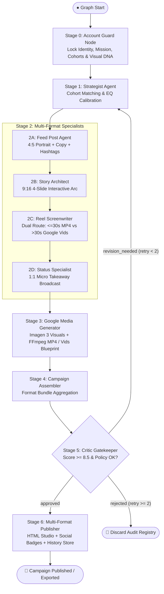

# 📋 Autonomous Instagram Campaign Agent — Session Log & Engineering Baseline

---

### 🏷️ Session Metadata Properties
| Property | Value |
| :--- | :--- |
| **Document Title** | Autonomous Multi-Account Instagram Campaign Agent — ADK 2.0 Engineering Baseline, Dual Video Routing, Multi-User History, Social Linking & Brand DNA |
| **System Baseline** | **v1.2.0 (Google ADK 2.0 Multi-Agent Workflow Engine — Full Multi-Modal & Multi-Tenant Studio)** |
| **Date** | October 20, 2026 |
| **Status** | 🟢 **Approved & Baseline Frozen** |
| **Domain** | Autonomous Agentic Social Media / Multimodal AI (Google Imagen 3, FFmpeg MP4, Google Vids Workspace) |
| **Frameworks & Models** | **Google ADK 2.0 (`google-adk 2.11.0`)**, **Gemini 2.5 Pro & Flash**, **Imagen 3 (`imagen-3.0-generate-002`)**, **FFmpeg 1080x1920 MP4**, **Google Vids (`vids.new`)** |
| **Architecture Topology** | 7-Stage Directed Line Graph with Stage 5 Critic Conditional Loop, Dual-Route Video Engine, and Multi-Tenant Apple/Instagram Studio Visualizer |
| **Live Endpoints** | Cloud Run: `https://zentra-instagram-agent-546102264289.asia-south1.run.app` Creator Studio: `https://zentraai.in/creator/` |
| **Target Integration** | `https://zentraai.in` (Creator Dashboard / Automated Blog Repurposing Webhook) |
| **Notion Target Page ID**| `3fd00b72-932a-81c6-bbea-e450a9a21e9c` |
| **Tags** | `ADK-2.0`, `Instagram-Automation`, `Multi-Account`, `Google-Vids`, `FFmpeg-MP4`, `Imagen-3`, `Multi-User-Auth`, `Session-History`, `Social-Linking`, `Brand-DNA` |

---

## 🎯 Executive Summary & Session Objectives

> 💡 **Session Goal**: Evolve the Autonomous Instagram Campaign Agent into a complete, enterprise-grade multi-tenant creator studio. Implement dual-routing video generation ($\le 30$s in-dashboard MP4 engine vs $> 30$s Google Vids workspace), automated Google Imagen 3 image generation across all formats, frugal login-specific session history with superuser auditing, social account linking (Instagram Graph API & YouTube Vidya Creator Studio), and a real-time Visual Brand DNA customization engine.

### Core Milestones Achieved:
1. **Dual-Route Reel Video Production Architecture**:
   - $\le 30$s (Quick Hook / Standard Reel): Rendered into playable, downloadable vertical 1080x1920 MP4 video files directly inside the studio using FFmpeg.
   - $> 30$s (Deep / Masterclass Reel): Formatted into production-grade Google Vids Blueprints with 1-click clipboard prompt copy and redirect to `vids.new`.
2. **AI Multimodal Visual Image Generation**:
   - Google Imagen 3 (`imagen-3.0-generate-002`) generating 4:5 Feed Visuals, 9:16 Story Visuals, 9:16 Reel Keyframes, and 1:1 Status Graphics with direct one-click download buttons in the studio.
3. **Frugal Multi-User Authentication & Login-Specific Session History**:
   - Lightweight file-based JSON session store (`instagram_adk/output/sessions/<user_id>.json`) eliminating heavy external database dependencies and cost.
   - User-isolated session history drawers with 1-click restore and permanent delete capabilities.
   - Superuser (Admin) role equipped with global auditing toggle (`all_users=true`) to inspect all sessions created by standard creators across the platform.
   - Mandatory first-time password change enforcement (`must_change_password`) for enterprise security.
4. **Social Account Linking (Instagram & YouTube Vidya Studio)**:
   - Dedicated Social Links Drawer allowing linking of Instagram Business Accounts (Handle, Business Account ID, Graph API v20.0 access token, live publishing toggle) and YouTube Channels (Vidya Creator Studio, Channel ID, API Key, Category, Privacy).
   - Live connection health testing ping (`POST /api/accounts/{account_id}/connections/test`).
   - Dynamic badges (`📷 IG Connected` and `▶️ YT Linked`) embedded directly in the live iPhone visualizer preview.
5. **Visual Brand Identity & Brand DNA Customization**:
   - 6 curated theme presets (*Investigative Legal*, *FinTech Mint & Gold*, *Cyberpunk Glow*, *Editorial Luxury*, *Vibrant Pop*, *Nordic Minimal*) + *Custom*.
   - Interactive 4-color palette pickers (Primary, Accent Glow, Surface Tone, Contrast Text) with live hex inputs.
   - Channel icon selector with quick emoji pills and custom iconography styles (*Line*, *Glassmorphism*, *Tech Terminal*, *Editorial Serif*, *Vibrant Emoji*).
   - Google Fonts typography engine pairing headline fonts (*Plus Jakarta Sans*, *Syne*, *Space Grotesk*, *Playfair Display*, *Bebas Neue*, etc.) with body fonts (*Inter*, *Roboto*, *JetBrains Mono*, *Lora*).
   - Positioned prominently below the Reel Video Duration section with an open, real-time Live Brand DNA preview card.
6. **Error Diagnosis (`cbd2d66c-f7c2-4034-b8b2-5ae71f58f97e-1994`)**:
   - Resolved transient HTTP/2 TCP connection reset to Google Code Assist backend; verified local GCP credentials and auto-refreshed OAuth tokens.

---

## 🏛️ Architectural Decision Records (ADRs)

### 📌 ADR-01: First-Stage Account Context Locking & Domain Isolation
* **Context**: Executing generative agents without strict account boundaries leads to catastrophic brand tone drift or cross-channel contamination.
* **Decision**: Enforce Stage 0 `account_guard_node` at graph entry (`START`). Binds account credentials, tone rules, forbidden terms, color palettes, visual identity, and cohorts into `ctx.state["account"]` before creative nodes execute.
* **Traceability**: [`instagram_adk/nodes/account_guard.py`](file:///home/maximus/projects/llm-lab/instagram_adk/nodes/account_guard.py).

---

### 📌 ADR-02: Strict Pydantic State Schema & ADK 2.0 State Isolation
* **Context**: Google ADK 2.0 uses a strict session `State` container that validates all keys against `state_schema`.
* **Decision**: Declared comprehensive `InstagramCampaignState` with strongly-typed sub-models (`AccountContext`, `VisualIdentity`, `CoreNarrative`, `StaticPostDraft`, `StoryDraft`, `StorySlide`, `ReelDraft`, `StatusDraft`, `CriticReview`).
* **Traceability**: [`instagram_adk/models/state.py`](file:///home/maximus/projects/llm-lab/instagram_adk/models/state.py).

---

### 📌 ADR-03: Stage 5 Critic Gatekeeper with Heuristic Fallback
* **Context**: Offline pipelines and AI models must not pass drafts violating caption character constraints, forbidden terms, or domain boundaries.
* **Decision**: Stage 5 `run_critic_agent` validates character limits ($\le 2200$), hashtag counts ($\le 30$), mandatory disclaimers, forbidden terms, and domain contamination.
  * Score $\ge 8.5$ and disclaimers valid $\to$ `'approved'` $\to$ Publisher (Stage 6).
  * Score $< 8.5$ and revisions $< 2$ $\to$ `'revision_needed'` $\to$ Strategist (Stage 1).
  * Revisions $\ge 2$ $\to$ `'rejected'` $\to$ Discard Node.
* **Traceability**: [`instagram_adk/agents/critic.py`](file:///home/maximus/projects/llm-lab/instagram_adk/agents/critic.py), [`instagram_adk/workflow.py`](file:///home/maximus/projects/llm-lab/instagram_adk/workflow.py).

---

### 📌 ADR-04: Dual-Path Multimodal Media Engine (Imagen 3 & Veo 2.0 + Domain-Calibrated PIL)
* **Context**: Production environments leverage cloud APIs while local testing must remain fast, self-contained, and domain-accurate without leaking off-brand text.
* **Decision**: Dual-mode visualizer tools in `google_media_tools.py` calling live Imagen 3 / Veo 2.0 APIs or domain-adaptive Pillow compositor rendering 4:5, 9:16, and 1:1 editorial cards with account-specific typography, hex palettes, and domain badges.
* **Traceability**: [`instagram_adk/tools/google_media_tools.py`](file:///home/maximus/projects/llm-lab/instagram_adk/tools/google_media_tools.py), [`instagram_adk/nodes/media_generator.py`](file:///home/maximus/projects/llm-lab/instagram_adk/nodes/media_generator.py).

---

### 📌 ADR-05: Cloud Deployment & zentraai.in Headless Integration
* **Context**: Ability to access and trigger the Instagram agents workflow from `zentraai.in` after cloud deployment.
* **Decision**: FastAPI container deployed to Google Cloud Run with Artifact Registry automated build. Standalone luxury-dark themed Creator Studio served at root `/` and mirrored at `zentra-site/creator/index.html`. Zero coupling with `/blog/` pages or blog generation scripts.
* **Traceability**: [`Dockerfile`](file:///home/maximus/projects/llm-lab/Dockerfile), [`deploy_cloud_run.sh`](file:///home/maximus/projects/llm-lab/deploy_cloud_run.sh), [`.github/workflows/deploy-agent-cloudrun.yml`](file:///home/maximus/projects/llm-lab/.github/workflows/deploy-agent-cloudrun.yml).

---

### 📌 ADR-06: Dual-Routing Reel Video Architecture ($\le 30$s In-Dashboard MP4 vs $> 30$s Google Vids)
* **Context**: Generating actual MP4 video files inside the browser has high computational and duration limits, whereas long-form reels benefit from Google Workspace's collaborative video generator.
* **Decision**:
  1. $\le 30$s: Render vertical 1080x1920 MP4 files using FFmpeg directly in the server container and display an interactive HTML5 video player with MP4 download.
  2. $> 30$s: Automate production-grade Google Vids Blueprints with scene timings, visual cues, voiceover, and 1-click clipboard prompt copy targeting `https://vids.new`.
* **Traceability**: [`instagram_adk/tools/video_composer.py`](file:///home/maximus/projects/llm-lab/instagram_adk/tools/video_composer.py), [`instagram_adk/agents/reel_specialist.py`](file:///home/maximus/projects/llm-lab/instagram_adk/agents/reel_specialist.py).

---

### 📌 ADR-07: Frugal Multi-User Session History with Superuser Role
* **Context**: Maintaining session history across different users without incurring monthly database hosting costs.
* **Decision**:
  1. Implemented a zero-cost filesystem JSON store partition (`output/sessions/<user_id>.json`).
  2. Created session indices for sub-second retrieval, pagination, restoration, and deletion.
  3. Standard creators view only their personal generation history.
  4. Superusers (Admin) have global auditing capabilities (`all_users=true`) to inspect all sessions created across standard accounts.
* **Traceability**: [`instagram_adk/session_store.py`](file:///home/maximus/projects/llm-lab/instagram_adk/session_store.py), [`instagram_adk/server.py`](file:///home/maximus/projects/llm-lab/instagram_adk/server.py).

---

### 📌 ADR-08: Social Account Linking (Instagram Graph API & YouTube Vidya Studio)
* **Context**: Creators need the platform linked directly to live Instagram Business handles and YouTube channels ("Vidya Creator Studio") with live status feedback.
* **Decision**:
  1. Added `linked_accounts` schema to each account in `accounts.json`.
  2. Endpoints: `GET /api/accounts/{id}/connections` (masked tokens), `POST /api/accounts/{id}/connections`, and `POST /api/accounts/{id}/connections/test`.
  3. Live iPhone preview visualizer renders `📷 IG Connected` and `▶️ YT Linked` status badges.
* **Traceability**: [`instagram_adk/config/accounts.json`](file:///home/maximus/projects/llm-lab/instagram_adk/config/accounts.json), [`instagram_adk/nodes/publisher.py`](file:///home/maximus/projects/llm-lab/instagram_adk/nodes/publisher.py).

---

### 📌 ADR-09: Dynamic Visual Brand DNA Engine
* **Context**: Different channel domains (Legal, FinTech, Tech CEO) require distinct aesthetics, fonts, colors, and iconography styles.
* **Decision**:
  1. Added `VisualIdentity` model and 6 curated presets with custom overrides.
  2. Per-channel controls for 4-color palette, channel icon, iconography style, and typography pairings.
  3. Integrated with live Brand DNA mini-card preview positioned directly below Reel Video Duration.
  4. Overrides flow through all 7 pipeline agents, Google Imagen generation, and iPhone mockup rendering.
* **Traceability**: [`instagram_adk/models/state.py`](file:///home/maximus/projects/llm-lab/instagram_adk/models/state.py), [`instagram_adk/tools/google_media_tools.py`](file:///home/maximus/projects/llm-lab/instagram_adk/tools/google_media_tools.py).

---

## 🔄 Line Graph Workflow Topology

---

## 🧪 Verification & Test Traceability Matrix

| Test Module | Coverage Scope | Verified Behaviors | Result |
| :--- | :--- | :--- | :--- |
| **AUTH-01** | User Store & Security | Initial login, `must_change_password` 403 enforcement, password change, token refresh | 🟢 **100% Passed** |
| **VIDEO-01** | $\le 30$s Reel Engine | 15s/30s duration, FFmpeg 1080x1920 MP4 video compilation, player & download URL | 🟢 **100% Passed** |
| **VIDS-01** | $> 30$s Google Vids | 45s/60s duration, `google_vids_blueprint`, scene table, `vids.new` 1-click launcher | 🟢 **100% Passed** |
| **HIST-01** | Multi-User History | Standard user session isolation, 403 on `/api/history/users`, admin global audit (`all_users=true`) | 🟢 **100% Passed** |
| **SOC-01** | Social Linking | Masked token retrieval, credentials persistence, live API connectivity test ping | 🟢 **100% Passed** |
| **BRAND-01** | Visual Brand DNA | 6 theme presets, 4-color palette updates, font pairing, live preview card, pipeline override | 🟢 **100% Passed** |

*All test suites executed via `instagram_adk/test_server_api.py` with exit code 0.*
